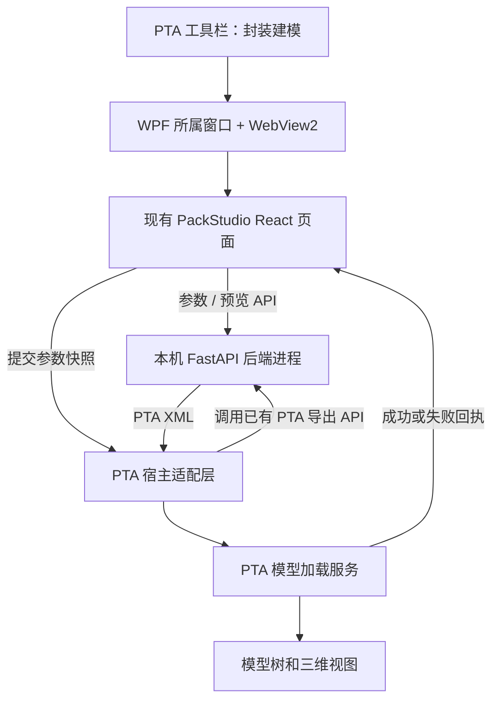

# PackStudio 嵌入 PTA 的技术分析

日期：2026-10-13。状态：方案建议，尚未实现 PTA 集成。

## 1. 结论与适用条件

保留 React / TypeScript / Three.js 前端和 Python / FastAPI 建模后端。
后续取得 PTA 源码后，推荐由 PTA 的 WPF 窗口通过 WebView2 承载 PackStudio 页面，
由 PTA 管理独立后端进程，再通过已有 PTA XML 导出接口接收并加载模型。
集成版无需启动 Electron；Electron 可以继续用于独立使用。

用户确认：目前只有本机安装版，后续可以修改源码，SDK 是否存在尚不清楚。
因此本阶段可以验证模型生成与交换格式；在取得源码或确认现有扩展接口前，
不能保证为当前安装版增加原生按钮，或把结果自动送入正在运行的 PTA 实例。
后续直接修改 PTA 源码即可实现宿主适配，不以获得专用插件 SDK 为前提。

本报告不改变 requirements.md 的既有功能基线，也不宣称集成已完成。

## 2. 已核实的本机与项目证据

### PTA 安装版

- 注册表显示 PTA 2.4.0，安装目录为
  `C:\Users\mydearlong\AppData\Local\Programs\PTA`。
- PTA.exe 产品名称为“PTA封装热分析软件”，产品版本为 2.4.0.0。
- PTA.runtimeconfig.json 指定 net10.0，包含 .NET 与 WindowsDesktop 10.0.12。
- PTA.deps.json 引用 HelixToolkit.Wpf、LiveCharts.Wpf、Xceed.Wpf.Toolkit；
  安装目录包含 PresentationFramework、AvalonDock 与 Fluent 程序集。
  这些依赖表明其界面使用 WPF，具体窗口和命令组织仍需源码确认。
- build-info.txt 说明该安装包是 2026-10-08 的主分支快照，记录源码提交
  `1b05f49b8c0b3d8474addba043eddbd8c6259792`，并非新的正式发布标签。
  联调应先核对取得的源码与该安装版的兼容性。
- 检查安装文件名及 Docs/Tools 内容，未发现明显命名的 SDK、插件或 WebView2 文件。
  这不证明 PTA 没有扩展能力，也未验证命令行打开文件或单实例通信能力。

### PackStudio

| 部分 | 当前实现 | 集成意义 |
| --- | --- | --- |
| 前端 | React 19、TypeScript、MUI、Three.js / R3F | 可在现代浏览器控件中复用参数向导与预览 |
| 后端 | Python 3.13、FastAPI、Pydantic、NumPy、lxml | 可独立运行，宿主通过 HTTP 调用 |
| 领域层 | PackageModel 与独立模板生成器 | 建模规则无需迁移到 C# |
| 静态资源 | api/app.py 可挂载 dist 或 PACKSTUDIO_FRONTEND_DIR | 单一本机地址提供页面与 API |
| 模型生成 | POST /api/templates/{template_id}/generate | 返回 PackStudio 的 JSON 领域模型 |
| PTA 导出 | POST /api/templates/{template_id}/export/pta | 接收参数并生成 XML，不必先调用 generate |
| 桌面分发 | Electron + PyInstaller onedir | 后端打包机制可复用，宿主替换 Electron 的职责 |
| 当前生成按钮 | PackageWorkspace.tsx 的 handleGenerate | 只更新本页面预览，尚未调用 PTA |
| 当前导出按钮 | api.ts 创建 Blob 下载链接 | 尚无向宿主提交模型与回执的协议 |
| 参数保存 | requestStorage.ts 使用 localStorage | 需增加与 PTA 项目关联的参数持久化 |

参考代码：src/packstudio/api/app.py、api/routes/templates.py、__main__.py、
exporters/pta_xml.py、domain/model.py、src/frontend/features/package-library/、
electron/main.cjs、tools/build_backend.py、electron-builder.yml。

## 3. 技术栈是否合适

适合该需求，主要改动在宿主适配和交付层。
WebView2 承载现有页面，Python 继续负责几何、材料、热源和 PTA 格式转换，
PTA 负责模型文档、模型树、网格、求解和结果。
界面与宿主语言不同并不妨碍集成；需要约定稳定的跨进程接口。

| 方案 | 评价 | 适用阶段 |
| --- | --- | --- |
| WPF + WebView2 + 本机 Python 服务 | 推荐；复用现有界面及规则，与 PTA 窗口生命周期协调 | 取得 PTA 源码后 |
| PTA 启动独立 Electron 窗口，通过文件/IPC 回传 | 可作为过渡，但仍需 PTA 的启动与接收接口，需维护额外桌面壳 | 已有插件/外部工具扩展点时 |
| 重写为 WPF + C# | 可以实现，但要迁移表单、预览、数值规则及回归用例，当前收益不足 | 出现禁止 WebView/Python 等明确约束时 |
| 在 C# 进程内嵌 Python | 增加解释器、ABI、依赖及异常隔离负担，当前不优先采用 | 有明确进程内调用需求时 |

集成版部署成本仍包含 Python 打包产物、WebView2 Runtime 和后台进程管理。
WebGL 三维预览应在实际 PTA 窗口、显卡及远程桌面环境中验收，尚未实测。
当前代码没有需要通过更换技术栈才能解决的集成阻碍。

## 4. 推荐架构与用户流程



1. PTA 用户点击“封装建模”，宿主启动或复用其管理的 PackStudio 服务。
2. 服务就绪并完成模板预热后，PTA 打开所属建模窗口，WebView2 加载同源本机页面。
3. 用户设置参数，可继续使用现有三维预览、材料库和模型树。
4. 集成模式下点击“生成并应用到 PTA”，页面向宿主提交当前参数的不可变快照。
5. 宿主通过 export/pta API 获取 XML，使用 PTA 自身的反序列化与校验路径构造临时模型。
6. 校验成功后，PTA 按约定的新建或替换语义提交模型，刷新模型树与三维视图。
7. PTA 返回应用成功回执，页面再提示完成；失败时保留参数并允许重试。

已有 export/pta 接口内部会 generate(request)，所以应用到 PTA 不要求先调用生成接口。
预览与提交都应使用明确的参数快照；不能把用户修改后的参数与旧预览混用。
如果将来需要一次请求同时返回预览与 XML，可增加组合结果接口，但不作为首版前提。
页面初始化时的自动预览不得触发 PTA 模型写入。

## 5. 通信协议建议

WebView2 支持网页与原生宿主交换 JSON 消息，见
[微软通信文档](https://learn.microsoft.com/en-us/microsoft-edge/webview2/how-to/communicate-btwn-web-native)。
建议页面发送参数，由宿主调用 HTTP 导出接口，避免用浏览器下载作为集成协议。

以下为待实现的消息示意，不是当前已有接口：

```json
{
  "protocol_version": "packstudio.host/v1",
  "type": "apply-model",
  "request_id": "本次提交的唯一标识",
  "session_id": "当前建模会话标识",
  "mode": "new-model",
  "parameters": "实际为现有 TemplateRequest JSON 对象"
}
```

宿主回执应包含 request_id、结果状态、PTA 文档/模型标识和可显示的错误。
宿主创建会话时绑定目标文档及其修订；不能在响应返回后直接写入当时恰好激活的其他文档。
校验完成前不改动 PTA 文档，连续点击按 request_id 去重；文档切换或修改后重新检查提交条件。
PTA 成功应用后记录参数、模板/服务版本与来源，便于重新打开向导编辑。

建议新增小型 HostBridge 接口，区分普通浏览器与 PTA 模式：
PTA 模式负责初始化上下文、提交和回执；浏览器模式继续保留现有导出能力。
后端领域层不直接访问 WPF 控件，PTA 的 UI 更新经其 UI 线程完成。

## 6. 新建、替换与追加的区别

首版建议实现“由封装模板新建一个完整 PTA 模型”。
用户要求的“PTA 中建成一个模型”可以通过该语义完成；是否需要将封装插入已有
PCB/整机模型，应在追加功能设计前另行确认。

当前 XML 根节点是完整 Structure，含 LengthUnit、StudyType、EnabledPhysics、
Layers、Materials 等模型级设置，不是任意可插入的组件片段。
获得源码后，应复用 PTA 的加载逻辑并确认文档行为，不能假设它已经提供某个 ImportModel 方法。

替换已有模型时，需要处理未保存内容，明确是否保留原有边界与求解设置；
不得直接把 XML 中的基础稳态设置覆盖到任意已有项目而不定义行为。
追加到已有模型还需处理：

- 材料同名异物性与实体标识冲突，所有热源/边界引用随映射一起更新。
- PackStudio 内部使用 mm、Z 向上、封装底面中心坐标；PTA XML 另有整体 Z 平移。
  插入位移必须记录，不能再次误用内部坐标或重复平移。
- PTA 的全局层栈需在合并后重新规划并校验；不能直接拼接两个 Layers 集合。
- 只有第一个顶层允许层内块厚不同于层厚。原封装顶层移到整体中间时须重新切片。
- 保持材料体积、总功率、布尔轮廓和层连续性，并处理几何重叠及撤销操作。

上述约束来自 requirements.md §3.1、output_format/README.md 和当前导出器。
直接映射 JSON 到 PTA 对象也必须承担这些转换，首版复用 XML 导出器更容易保持现有契约。

## 7. 两侧改动与打包

### PackStudio 侧

- 新增 HostBridge 与宿主模式入口，将按钮提交动作接入回执状态。
- 将页面请求中的后端地址/会话配置集中管理，兼容宿主动态端口。
- 保留现有建模与导出器；仅在需要时扩展组合生成结果和服务版本/能力信息。
- 参数由 PTA 项目存储并随项目恢复。动态端口改变 HTTP origin，localStorage
  不能充当项目参数记录；仍可保留为独立版便利功能。
- 复用 npm run build 和现有 PyInstaller onedir 后端打包，不以 start.ps1 或 Vite 开发服务交付。

### PTA 侧

- 新增工具栏命令、所属 WPF 建模窗口与 Microsoft.Web.WebView2 依赖。
- 新增后端启动器、健康/版本检查、模板预热、超时与日志处理。
- 新增消息适配、模型加载事务、文档上下文核对、模型树和视图刷新。
- 保存封装生成参数与版本信息，支持取消、重试、撤销和再次编辑的明确行为。
- 由 PTA 安装器分发前端静态文件、完整 PyInstaller 后端目录及默认参数库。
  不能只复制 packstudio-backend.exe 而遗漏 onedir 依赖与数据资源。

服务继续绑定 127.0.0.1，通过 PACKSTUDIO_FRONTEND_DIR 指定前端目录。
宿主动态分配端口并处理绑定失败重试；仅清理自己创建的进程，可采用 Windows Job Object。
复用服务时检查身份、版本和能力，不能仅凭 8000 端口返回 HTTP 200 就认定兼容。
当前 Electron 的健康探测只检查 response.ok，宿主集成应完善这一点。
宿主消息验证来源并使用会话凭据；当前 API 尚无宿主会话鉴权，需随集成新增。

WebView2 Runtime 应纳入安装检测与部署方案，离线环境需准备相应安装产物；见
[微软分发文档](https://learn.microsoft.com/en-us/microsoft-edge/webview2/concepts/distribution)。
开发机使用 uv 与 Node 构建；最终用户通过打包产物运行，无需自行安装开发工具链。

## 8. 推进顺序与验收

1. 当前安装版阶段：用现有 PackStudio 导出 XML，在目标 PTA 手动打开，确认八类代表模型。
   先确认实际模型树、体积、各向异性材料、总功率、网格控制与坐标方向。
   只有发现已有且可验证的文件打开参数或插件接口后，才推进安装版自动导入。
2. 取得源码：检查工具栏命令、模型反序列化、当前文档管理、刷新及撤销路径；
   确认现有扩展点，无需为单个内部模块先建立完整插件框架。
3. 首个纵向实现：一个模板完成“PTA 按钮 → 建模窗口 → 参数 → 新建 PTA 模型 → 回执”。
4. 覆盖八类模板及失败路径，完成一键交付；之后根据需要扩展项目参数回存与现有模型追加。

首版验收包括：一次提交只生成一个目标模型；取消不改 PTA；导入失败不留下半成品；
多窗口/文档切换不写错目标；退出无孤儿服务；端口占用能恢复；离线且无 uv/Node 的机器可运行；
八类模型的层顺序、非顶层等厚、材料、功率与现有导出一致；PTA 网格/求解仍由 PTA 负责。

本次未启动或修改 PTA，未验证其 GUI 导入、网格或求解；未取得 PTA 源码，
所以具体命令/模型服务名称、SDK、命令行参数及单实例通信仍待确认。
仓库自动化验证结果见本次 docs/git_commits/ 提交说明。

## 9. 外部依据

- [Microsoft：WPF 中使用 WebView2](https://learn.microsoft.com/en-us/microsoft-edge/webview2/get-started/wpf)
- [Microsoft：网页与原生宿主通信](https://learn.microsoft.com/en-us/microsoft-edge/webview2/how-to/communicate-btwn-web-native)
- [Microsoft：分发 WebView2 Runtime](https://learn.microsoft.com/en-us/microsoft-edge/webview2/concepts/distribution)

技术选型为结合上述控件能力与本机安装证据的工程建议，尚未完成 PTA 实机集成验证。
