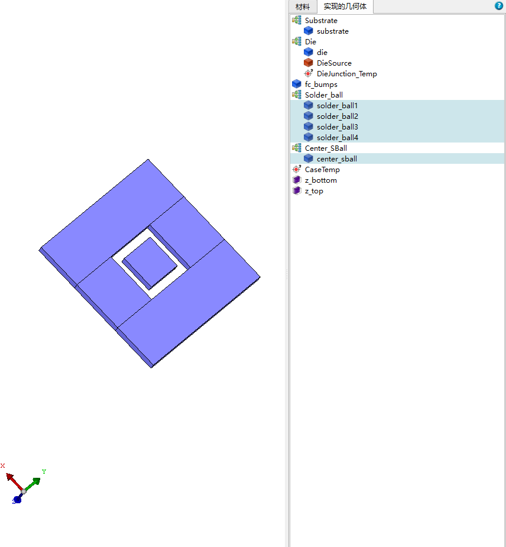

# TASK2 — Flip Chip CBGA / BGA 模板构建

## 状态

已完成（2026-07-11）。

参照PLAN.md中阶段3的目标和任务，构建 Flip Chip CBGA / BGA 模板 (目前只支持这个部分)。

目前这个模板可以完全参考Flotherm PACK的截图示例。

其中各向异性层的等效方法见./docs/各向异性等效层/micro_c4_bump_underfill_anisotropic_layer_derivation.md中第4节的推导。

对于中央去球，或者中央焊球等焊球分布在层中不均匀的情况，抽取有均匀焊球的部分等效为各向异性矩形块，剩下部分不建模或者填入均匀underfill材料

## 执行记录

- [x] 建立统一的几何、材料、热源、边界和模型树领域对象
- [x] 实现基板、芯片、flip-chip bumps、underfill、焊球、散热块和顶盖生成器
- [x] 实现全阵列、交错、中央去球、中央焊球和自定义去球模式
- [x] 实现等体积离散方柱及其基体分块
- [x] 按推导文档第 4 节实现各向异性等效导热、密度和比热
- [x] 对中央非均匀分布进行确定性矩形分区，并支持省略或填充 underfill
- [x] 实现几何包络、阵列、层叠、引用、材料完整性和无重叠校验
- [x] 接入模板目录、默认参数、JSON 生成和 PTA XML 导出 API
- [x] 完成参数化界面、三维块预览、模型树选择和错误提示
- [x] 精简 PTA XML，仅保留输入模型数据，不导出网格和求解结果
- [x] 新增手算公式、小阵列、默认参考模型、API 和 XML 契约测试
- [x] 更新 README、PLAN、模板文档和 ADR
- [x] 生成提交说明并执行 `git add`（未执行 `git commit`）

## 验收结果

- 默认模型为 8 个块：基板、芯片、1 个凸块等效层、4 个外围焊球等效块和 1 个中央焊球
  等效块；物理凸块和焊球数量均为 49。
- 默认中央焊球模型树含 4 个 `Solder_ball` 外围块和 1 个 `Center_SBall` 子组块，匹配参考图。
- 后端 30 项测试通过，覆盖手算等效属性、质量/热容守恒、坐标、包络、重叠、层叠、边界、
  API 和 PTA XML。
- 前端组件测试、ESLint、TypeScript 和 Vite 生产构建通过。
- PTA XML 结构测试确认不存在 `Mesh*`、`Results`、`LayerPBResults` 和
  `ThermalMaskResults` 节点；这些数据由 PTA 求解阶段生成。
