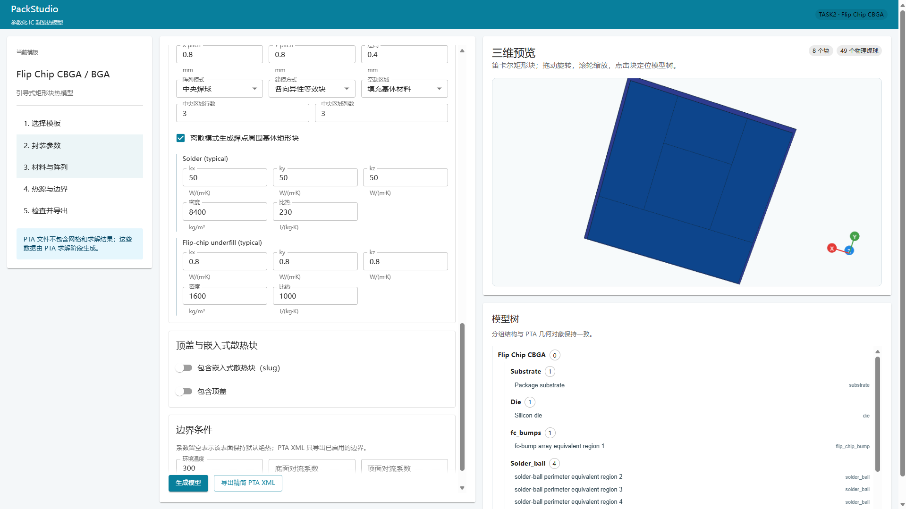
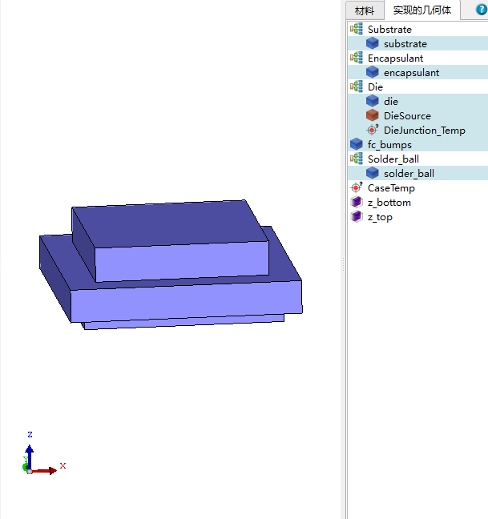

# TASK3：四栏工作区、材料库、模型显隐与可选塑封

**状态**：已完成（2026-07-12）

## 1. 修改 UI

改为四栏:

1. 最左侧:列表内容顺序：
   - 汇总
   - 封装基底
   - 芯片
   - 塑封
   - 倒装芯片凸块
   - 焊球
   - 焊球去除
   - 中央焊球
   - 顶盖
   - 插入式散热块
   - 建模选项
无须严格参照，借鉴即可。
2. 中左侧:属性列表，根据最左侧列表内容进行切换。
3. 中右侧:三维建模区
4. 最右侧：tab切换的材料库/模型树
   - 选中材料，最右侧上下分为两栏：
     - 上栏：材料库
     - 下栏：材料属性，比热容，密度，导热系数等

中间两栏可以通过鼠标拖拉改变横向宽度。

## 2. 材料属性

将比热容，密度，导热系数等属性绑定到材料中。

中左侧属性列表中，可以选择矩形块（underfill、substrate、凸点等）的材料属性。

## 3. 模型树点击行为

可以右键模型树中的模型，选择隐藏这个模型，或者只显示这个模型。

## 4. 增加可选的塑封

如图，Flotherm Pack中的例子

## 5. 实施结果

- 工作区改为“结构导航 / 属性编辑 / 三维预览 / 材料库与模型树”四栏布局；属性栏与预览栏之间
  可通过鼠标拖动或键盘方向键调整宽度。
- 结构导航按封装部件切换属性页；生成、导出和脏状态提示保留在属性栏底部。
- 材料库按材料 ID 集中管理名称、颜色、三向导热率、密度和比热。结构属性只选择材料，编辑
  共享材料会同步更新所有引用该材料的结构。
- 模型树支持右键隐藏当前块、仅显示当前块和恢复全部；此状态仅影响浏览器预览，不修改生成
  模型或 PTA 导出内容。
- 增加默认关闭的塑封选项。塑封外包络由长宽参数控制，内部避让芯片；几何按凸块层和芯片层
  拆为两层、每层四个无重叠矩形块，保持 PTA 连续分层约束。
- 塑封启用且没有顶层结构时，顶面对流会覆盖芯片顶面和塑封上表面。

## 6. 验收记录

- [x] 后端全量测试：`37 passed`
- [x] Ruff 检查：通过
- [x] Ruff 格式检查：通过（32 个文件）
- [x] ESLint：通过
- [x] TypeScript 编译与 Vite 生产构建：通过
- [x] 前端组件测试：本轮实现阶段执行通过（3 个测试文件、7 项测试）
- [x] 已完成四栏布局、无底面网格和右下角右手坐标系的浏览器视觉检查
- [x] 已更新模板说明、长期计划、ADR 和提交说明
