# Flotherm PACK 参考与界面解读

本文根据仓库中的 14 张界面截图进行功能解读，用于 PackStudio 的初期产品和 UI 设计参考。
截图没有覆盖所有控件状态，因此以下内容是对可见界面的工程理解，不作为 Siemens 产品的
正式规格说明。

## 总体工作方式

参考流程可概括为：先选择封装拓扑和标准外形，再沿固定步骤填写结构参数；界面同步展示
参数示意图、三维几何、材料库和已实现的几何树；最后选择详细/等效建模方式。它将一个复杂
封装拆成有限的、可校验的组件，避免用户从空白三维场景手工建模。

## Step 1：选择起始模板

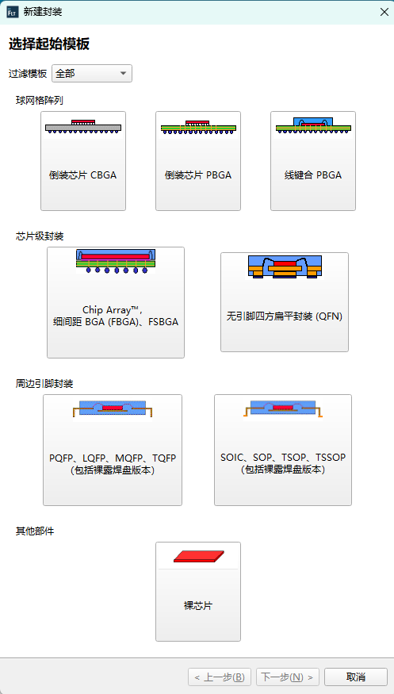

界面按球栅阵列、芯片级封装、周边引脚封装和其他部件分组展示模板卡片，并提供过滤器。
可见模板包括 Flip Chip CBGA/PBGA、Wire-bond PBGA、FBGA/FSBGA、QFN、QFP、
SOIC/SOP/TSOP/TSSOP 和裸芯片。

**功能和作用**：先确定封装的拓扑结构。后续步骤、参数字段、默认材料和生成规则都由模板
决定；带剖面小图的卡片让用户在不了解内部命名时也能辨认结构。

## Step 2：定义模板基本信息

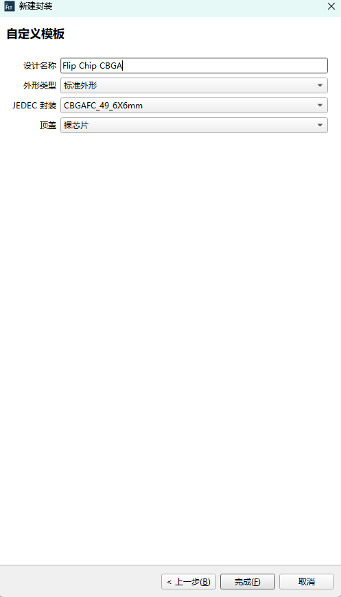

选择 Flip Chip CBGA 后，界面要求填写设计名称，并选择外形类型、JEDEC 封装规格和顶盖
形式。这里显示的是“标准外形 + CBGAF C_49 6×6 mm + 裸芯片”。

**功能和作用**：把通用模板实例化为具体设计，同时用标准封装预设填入一组相互一致的初始
尺寸。用户只需修改偏离标准的参数，减少输入量和组合错误。

## Step 3：选择 JEDEC 封装预设

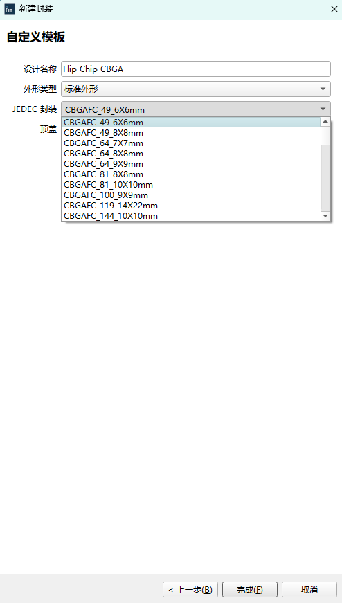

下拉列表给出多个 CBGAFC 规格，名称中体现焊球数量和封装外形尺寸，例如 49/6×6 mm、
64/9×9 mm、81/10×10 mm 等。

**功能和作用**：用行业规格驱动基板尺寸、焊球阵列和间距等默认值。预设是参数起点，不应
替代后续几何约束检查。

## Step 4：选择顶部结构

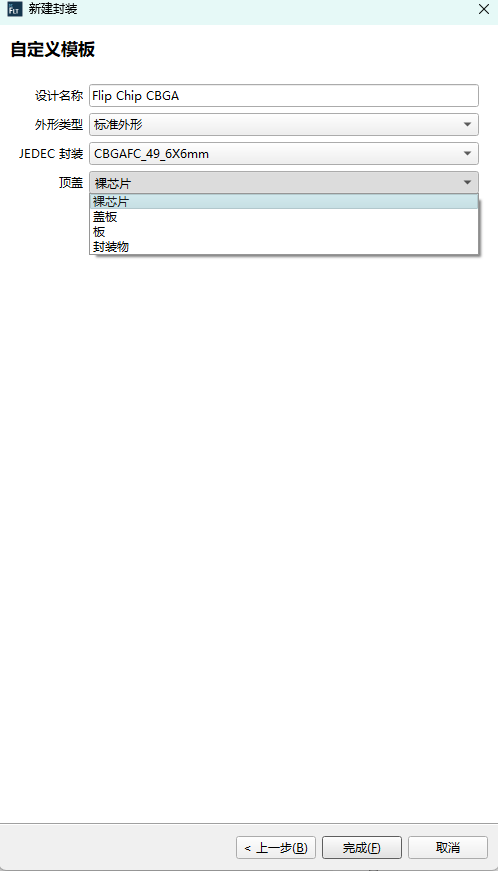

“顶盖”下拉框提供裸芯片、盖板、板和封装物等不同顶部构造。

**功能和作用**：决定芯片上方是否存在额外的传热路径和几何层，也决定后续是否出现顶盖、
界面材料或封装体的参数页面。条件式步骤可以隐藏与当前结构无关的输入。

## Step 5：进入主建模工作区

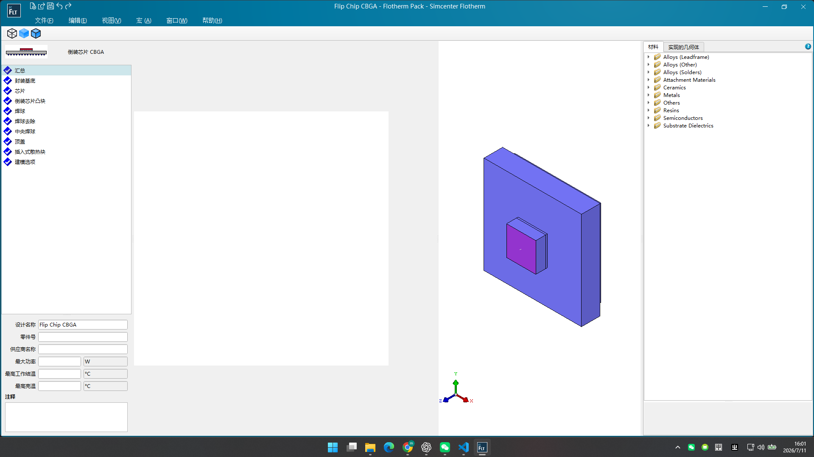

主界面采用四区布局：左侧是固定的建模步骤和设计摘要；中间是当前参数页及尺寸示意图；
右中是持续更新的三维预览；最右侧可在材料库和已实现几何之间切换。摘要包含设计名称、
零件号、供应商、最大功率、温度限制和注释。

**功能和作用**：把“输入—解释—反馈”放在同一屏。步骤导航保证结构输入顺序，示意图解释
符号含义，三维预览帮助发现层叠和尺度错误，材料面板支持复用工程属性。

## Step 6：检查已实现的几何体

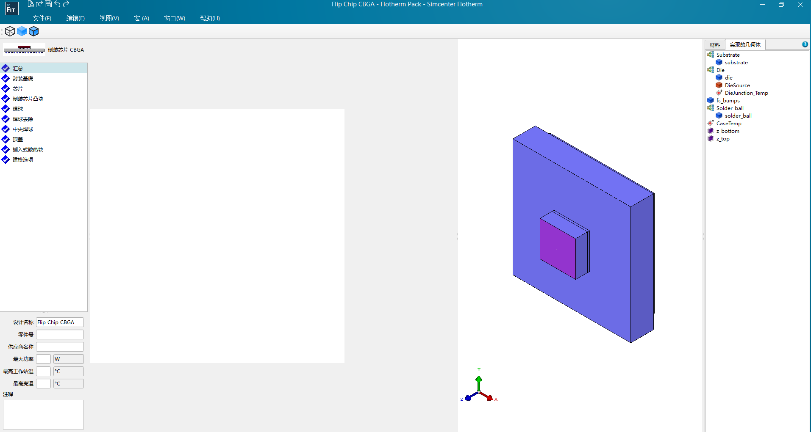

“实现的几何体”树按 Substrate、Die、fc_bumps、Solder_ball 等语义组件组织实体，并列出
DieSource、结温、壳温以及顶部/底部参考面等非实体对象。

**功能和作用**：展示参数最终映射成了哪些求解对象，便于定位对象、核对缺失组件和理解热源
或监测量附着在哪里。该树应与三维选中状态双向联动。

## Step 7：配置封装基底

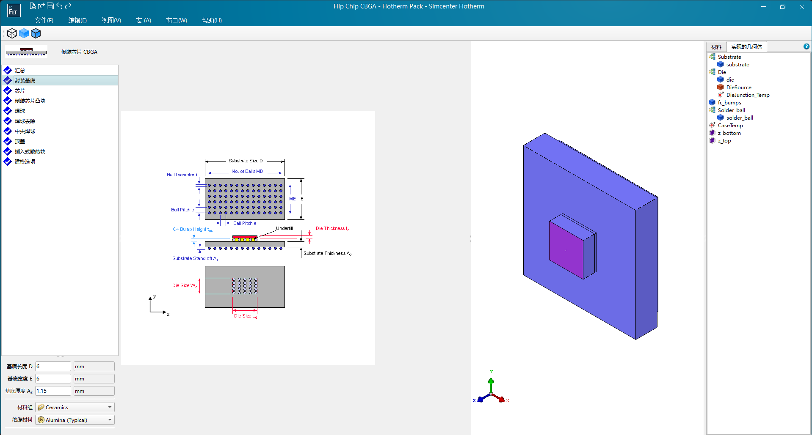

页面用顶视图和侧视图标注基板长度 D、宽度 E、厚度 A2、离板高度 A1 以及焊球相关尺寸；
下方输入具体数值，并从材料分组中选择基板材料。

**功能和作用**：建立整个封装的外形边界、厚度方向基准和底部参考面。基板也是芯片、凸块和
焊球定位的父结构，因此这些参数会约束多个后续步骤。

## Step 8：配置芯片与热源

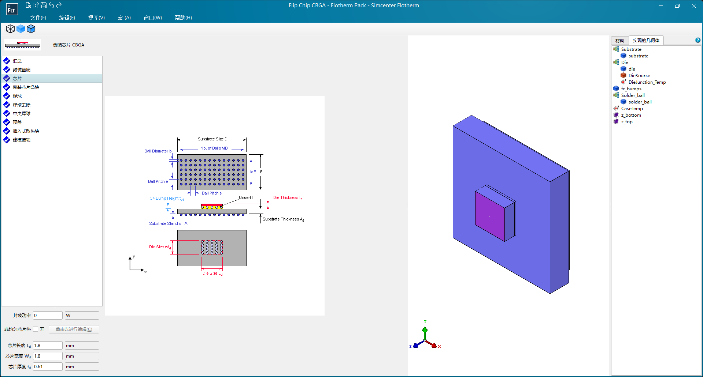

页面输入封装功率、芯片长度 Ld、宽度 Wd 和厚度 td，并提供“非均匀芯片热”开关及编辑入口。

**功能和作用**：同时定义发热实体和热源。默认功率可作为均匀体热源或面热源；开启非均匀
模式后，应允许多个功率区并校验其范围、重叠关系和总功率。

## Step 9：配置 Flip-chip 凸块与底部填充

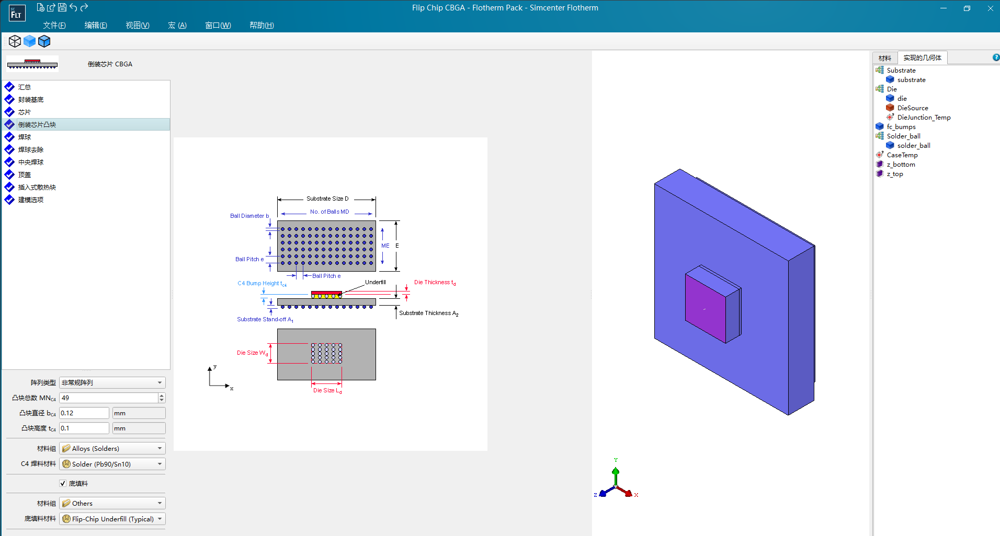

页面选择阵列类型，输入凸块总数、直径和高度，指定焊料；还可启用 underfill 并选择底填
材料。示意图将凸块阵列与芯片、基板的相对位置放在同一尺寸体系中。

**功能和作用**：建立芯片到基板的主要热连接。凸块与 underfill 可以分别离散表达，也可以在
后续建模选项中合并为等效层；无论采用哪种表达，都应保留原始阵列参数。

## Step 10：配置焊球去除模式

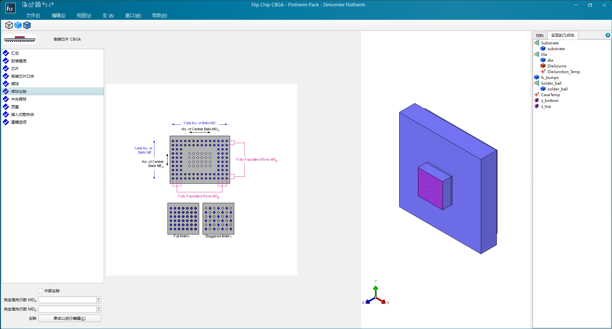

页面展示满阵列、交错阵列和中央空区，并提供中央去除、完全填充行数及自定义编辑入口。

**功能和作用**：在规则行列阵列的基础上表达 BGA 常见的去球模式。通过参数化外圈和中央
区域，可避免逐个放置焊球；自定义编辑器用于覆盖不能被规则描述的例外位置。

## Step 11：控制中央焊球

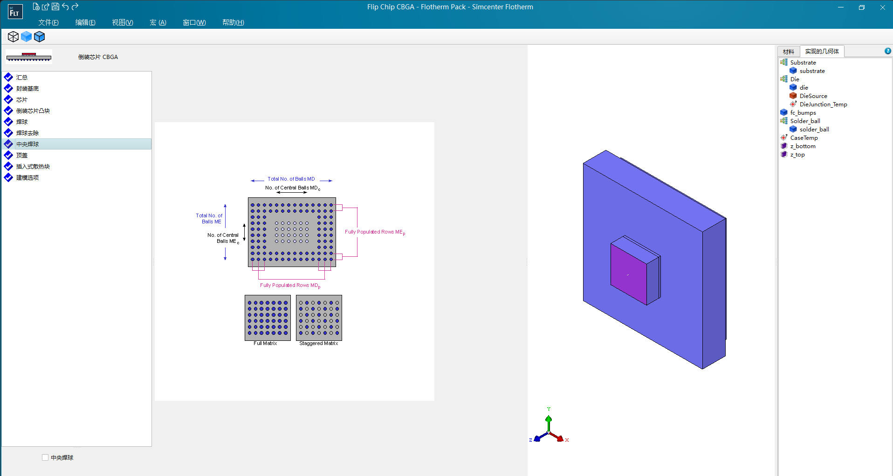

该页提供独立的“中央焊球”开关，示意图沿用上一页的中心区域定义。

**功能和作用**：明确中央区域是空置还是保留焊球，并与外圈填充规则解耦。实现时应避免该
开关与 Step 10 的中央去除设置产生矛盾，并给出确定的优先级或互斥关系。

## Step 12：在主流程中确认顶盖

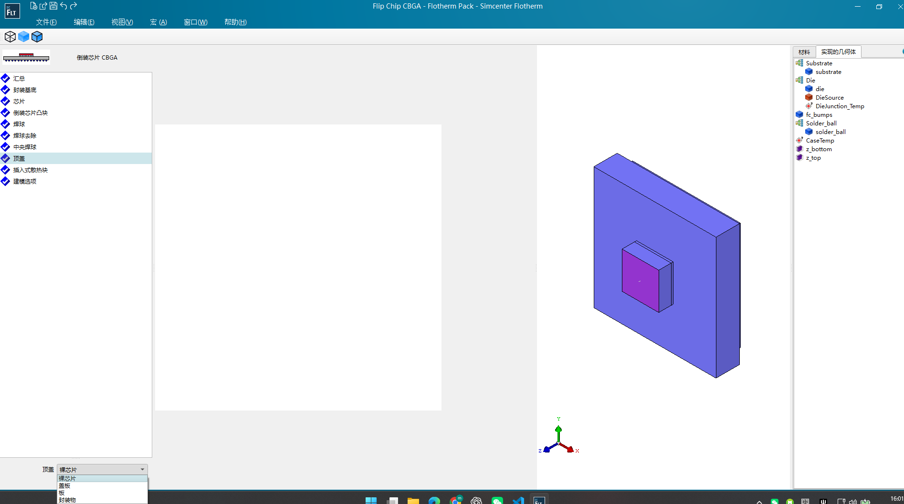

进入具体模型后仍可选择裸芯片、盖板、板或封装物，三维预览随选择更新。Step 4 是创建实例
前的拓扑预设，本页则是模型内可回看、可修改的正式参数步骤。

**功能和作用**：允许用户调整顶部传热结构，同时触发相关几何和材料参数的增删。切换结构时
应提示哪些既有参数会被保留、停用或删除。

## Step 13：配置嵌入式散热块（Slug）

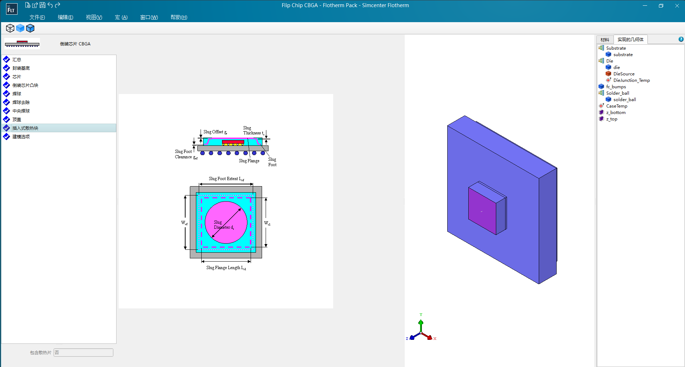

示意图标注 slug 的厚度、偏移、底脚间隙、法兰尺寸和直径；当前“包含散热片”为“否”，
因此详细字段未启用。

**功能和作用**：可选地在封装体内增加高导热扩散结构，形成从芯片向更大面积传热的路径。
页面采用条件式表单：关闭时不生成相关块，开启后才要求完整几何和材料参数。

## Step 14：选择模型表达精度

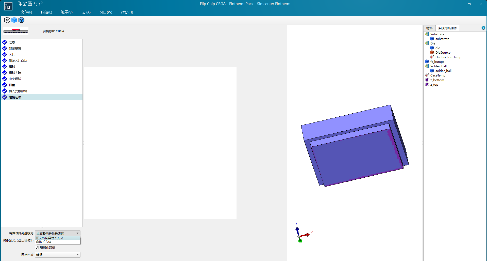

“建模选项”允许把焊球阵列/凸块阵列表示为正交各向异性长方体或离散长方体，并可设置局部
网格与网格密度。三维视图用于确认最终表达。

**功能和作用**：在计算规模与局部细节之间做取舍。离散块保留单个连接点，等效块显著减少
对象数量但需要可靠的各向异性材料计算。PackStudio 应保留“离散/等效”选择和假设说明；
局部网格设置属于下游网格模块，当前不纳入本项目功能。

## 对 PackStudio 的设计启示

1. 先选拓扑，再显示与之相关的步骤，避免向用户暴露无效参数。
2. 每个参数页都应同时提供符号示意、单位、范围和即时三维反馈。
3. 左侧步骤负责流程和完成状态，右侧对象树负责最终模型可追溯性，两者职责不同。
4. 内部统一保存原始参数；离散块或等效块只是可切换的生成策略。
5. 模型生成前执行跨步骤校验，例如阵列包络、层叠顺序、重叠、总功率和材料完整性。
6. UI 可以借鉴工作流，但 PackStudio 的功能范围必须以 `requirements.md` 为准，不能因参考
   产品存在网格选项而引入网格或求解职责。
